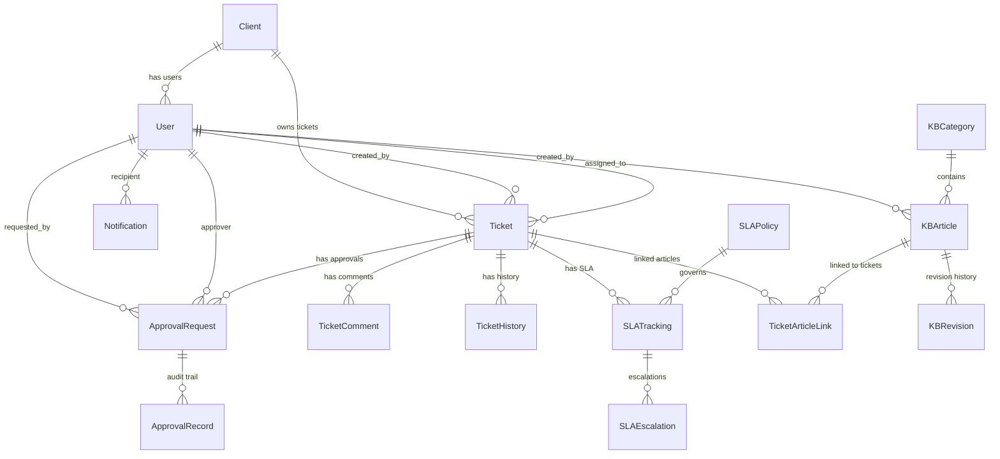

# ServiceSphere — Backend Architecture

> This document explains how the backend is organised, how data flows between its components, and
> the rationale behind key design decisions. It is intended for new contributors and reviewers who
> need a mental model of the system before diving into the code.

---

## Table of Contents

1. [High-Level Overview](#1-high-level-overview)
2. [Application (App) Inventory](#2-application-app-inventory)
3. [App Dependency Graph](#3-app-dependency-graph)
4. [Data Model Relationships](#4-data-model-relationships)
5. [Key Workflow Data Flows](#5-key-workflow-data-flows)
   - 5.1 [Ticket Creation](#51-ticket-creation)
   - 5.2 [SLA Monitoring & Automated Escalation](#52-sla-monitoring--automated-escalation)
   - 5.3 [Approval Workflow](#53-approval-workflow)
   - 5.4 [Knowledge Base Article Linking](#54-knowledge-base-article-linking)
   - 5.5 [Analytics & KPI Computation](#55-analytics--kpi-computation)
6. [Authentication & Authorization](#6-authentication--authorization)
7. [Background Task Architecture (Celery)](#7-background-task-architecture-celery)
8. [Key Design Decisions](#8-key-design-decisions)
9. [Configuration & Environment](#9-configuration--environment)
10. [Logging Strategy](#10-logging-strategy)
11. [Testing Strategy](#11-testing-strategy)

---

## 1. High-Level Overview

ServiceSphere is a **multi-tenant Help Desk / Support Ticket Management System** built with:

| Layer             | Technology                                                   |
|-------------------|--------------------------------------------------------------|
| Web Framework     | Django 6.x                                                   |
| REST API          | Django REST Framework (DRF) 3.x                              |
| Database          | PostgreSQL (port 5433 in development)                        |
| Task Queue        | Celery with Redis broker                                     |
| Auth              | Session-based (`SessionAuthentication` + `BasicAuthentication`) |
| Email             | Django's built-in email backend (SMTP, configurable)         |
| Environment       | Windows 10/11, Conda, VS Code                                |

The backend exposes a pure REST API consumed by a React SPA (not yet developed). All business
logic, permission enforcement, and background automation live in the Django backend.

---

## 2. Application (App) Inventory

```
backend/
├── config/            # Django project settings, root URL conf, WSGI/ASGI entry points, Celery app
├── core/              # Health-check endpoint; shared base classes (no domain models)
├── accounts/          # Custom User model, roles, auth endpoints, shared utilities
├── clients/           # Client (tenant) organizations, multi-tenancy isolation
├── tickets/           # Help-desk tickets, comments, file attachments, ticket history
├── approvals/         # Approval-request workflow and immutable audit trail
├── sla/               # SLA policies, deadline tracking, breach detection, escalations
├── notifications/     # In-app and email notifications, user preferences, unread counters
├── knowledge_base/    # KB categories, articles, article revisions, ticket linking
├── analytics/         # Ticket stats, agent performance, SLA metrics, KPIs, KRAs, CSV export
└── scripts/           # One-off management utility scripts (not part of the API surface)
```

---

## 3. App Dependency Graph

The arrow `→` means "imports from / depends on the target app's models or services".

```
config
  └─→ (all apps, via INSTALLED_APPS and ROOT_URLCONF)

core                      (no domain model dependencies)

accounts
  └─→ clients             (User.client FK, using lazy string reference "clients.Client")

clients
  └─→ accounts            (clients.permissions imports User for role checks)

tickets
  ├─→ accounts            (created_by, assigned_to FKs → User)
  └─→ clients             (Ticket.client FK → Client)

approvals
  ├─→ tickets             (ApprovalRequest.ticket FK → Ticket)
  └─→ accounts            (requested_by, approver FKs → User)

sla
  ├─→ tickets             (SLATracking.ticket FK → Ticket; directly imports Ticket model)
  └─→ accounts            (escalation assignee FK → User)

notifications
  ├─→ accounts            (Notification.recipient FK → User)
  ├─→ tickets             (notify_ticket_* functions accept Ticket objects)
  ├─→ approvals           (notify_approval_* functions accept ApprovalRequest objects)
  └─→ sla                 (notify_sla_* functions accept SLATracking / SLAEscalation objects)

knowledge_base
  ├─→ accounts            (created_by, updated_by FKs → User)
  └─→ tickets             (TicketArticleLink.ticket FK → Ticket)

analytics
  ├─→ tickets             (queries Ticket, TicketHistory, TicketComment)
  ├─→ accounts            (queries User for agent performance)
  └─→ sla                 (queries SLATracking, SLAEscalation for SLA metrics)
```

> **Circular-import boundary:** `tickets` ↔ `sla` and `tickets` ↔ `notifications` create
> potential circular imports. These are resolved by **deferred (inside-function) imports** for
> cross-app service calls. See [Section 8](#8-key-design-decisions) for details.

---

## 4. Data Model Relationships

The diagram below shows primary foreign-key relationships across all apps.
Cardinality notation: `||--o{` = one-to-many (zero or more).



### Key FK Constraints

| Relationship | `on_delete` | Rationale |
|---|---|---|
| `Ticket.client → Client` | `PROTECT` | Prevents orphaning open tickets when a client is deleted |
| `Ticket.created_by → User` | `PROTECT` | Preserves ticket ownership even if the user account is deactivated |
| `Ticket.assigned_to → User` | `SET_NULL` | Allows agent removal without deleting their historical ticket records |
| `ApprovalRequest.ticket → Ticket` | `PROTECT` | Approval audit trail must remain traceable to its ticket |
| `ApprovalRecord.approval_request → ApprovalRequest` | `PROTECT` | Immutable audit log; records must never be cascade-deleted |
| `TicketHistory.ticket → Ticket` | `PROTECT` | Audit logs survive ticket lifecycle to meet compliance requirements |
| `SLATracking.ticket → Ticket` | `CASCADE` | SLA tracking record is meaningless without its ticket |
| `User.client → Client` | `SET_NULL` | Keeps user accounts intact if a client organization is removed |

---

## 5. Key Workflow Data Flows

### 5.1 Ticket Creation

```
CLIENT user
  │
  ▼
POST /api/tickets/
  │
  ▼
TicketViewSet.perform_create()
  ├─ Sets created_by = request.user
  ├─ Sets client = user.client (enforced for CLIENT role)
  ├─ Saves Ticket (status=OPEN, priority from payload)
  │
  ├─ [deferred import] from sla.services import assign_sla_to_ticket
  │     └─ Finds active SLAPolicy matching ticket.priority
  │         └─ Creates SLATracking(response_deadline, resolution_deadline)
  │
  └─ [deferred import] from notifications.services import notify_ticket_created
        └─ Creates Notification(recipient=assigned_agent)
            └─ Sends email to assigned_agent (if email configured)
```

### 5.2 SLA Monitoring & Automated Escalation

```
Celery Beat Scheduler  (every 5 minutes)
  │
  ▼
sla.tasks.monitor_sla_deadlines_task()
  │
  ▼
sla.services.evaluate_sla_monitoring_and_escalations()
  │
  ├─ Queries SLATracking where:
  │     status ∈ {ACTIVE, RESPONSE_BREACHED}
  │     AND ticket.status NOT IN {RESOLVED, CLOSED}
  │
  ├─ For each tracking record:
  │     ├─ Check response_deadline  → if past → mark RESPONSE_BREACHED
  │     └─ Check resolution_deadline → if past → mark RESOLUTION_BREACHED
  │
  ├─ For breached records with no recent escalation:
  │     ├─ Creates SLAEscalation record (tier 1 → 2 → 3)
  │     └─ sla.services.trigger_escalation()
  │           └─ [deferred import] notify_sla_escalated()
  │                 ├─ Creates Notification(recipient=assigned_agent)
  │                 └─ Sends email alert
  │
  └─ Saves updated SLATracking (status, breach timestamps)
```

### 5.3 Approval Workflow

```
AGENT/ADMIN
  │
  ▼  POST /api/approvals/
ApprovalRequestViewSet.perform_create()
  ├─ Validates: only SUPPORT_AGENT or ADMIN can submit
  ├─ Creates ApprovalRequest(status=PENDING)
  ├─ Creates ApprovalRecord(action=SUBMITTED)  ← immutable audit
  └─ notify_approval_submitted(approval_req)

  │
  ▼  POST /api/approvals/{id}/approve|reject|request-info/
ApprovalRequestViewSet.approve|reject|request_info()
  ├─ Validates: only designated approver or ADMIN
  ├─ Validates: status must be PENDING (or INFO_REQUESTED for approve/reject)
  ├─ Updates ApprovalRequest.status
  ├─ Creates ApprovalRecord(action=APPROVED|REJECTED|INFO_REQUESTED)  ← immutable
  └─ notify_approval_decided(approval_req, decision, comment)

  │  (if INFO_REQUESTED)
  ▼  POST /api/approvals/{id}/resubmit/
ApprovalRequestViewSet.resubmit()
  ├─ Validates: only original requester or ADMIN
  ├─ Validates: status must be INFO_REQUESTED
  ├─ Resets ApprovalRequest.status → PENDING
  ├─ Creates ApprovalRecord(action=RESUBMITTED)  ← immutable
  └─ notify_approval_resubmitted(approval_req)
```

### 5.4 Knowledge Base Article Linking

```
AGENT/ADMIN searches KB
  │
  ▼  GET /api/knowledge/articles/?search=<query>
KBArticleViewSet.list()   (read access for authenticated users)

  ▼  POST /api/knowledge/articles/{id}/link-ticket/
KBArticleViewSet.link_ticket()
  ├─ Validates ticket belongs to agent's scope
  └─ Creates TicketArticleLink(ticket=..., article=...)

  ▼  GET /api/tickets/{id}/   (ticket detail)
     → serializer includes linked_articles[]
```

### 5.5 Analytics & KPI Computation

```
ADMIN/MANAGER
  │
  ▼  GET /api/analytics/tickets/
TicketAnalyticsView → analytics.services.get_ticket_summary()
  └─ Django ORM aggregation queries (COUNT, GROUP BY) on Ticket table

  ▼  GET /api/analytics/agents/
AgentPerformanceView → analytics.services.get_agent_performance()
  └─ Aggregation on Ticket + TicketHistory for response/resolution durations
     NOTE: Duration arithmetic is performed in Python (not SQL) — O(N) rows loaded per agent.
     Scale boundary: safe up to ~50,000 tickets / ~50 agents before cache layer is recommended.

  ▼  GET /api/analytics/sla/
SLAAnalyticsView → analytics.services.get_sla_summary()
  └─ Aggregation on SLATracking + SLAEscalation

  ▼  GET /api/analytics/kpi/
KPIView → analytics.services.get_kpi_metrics()
  └─ Composite aggregation across Ticket + SLATracking + TicketHistory

  ▼  GET /api/analytics/reports/export/?format=csv
ReportExportView → analytics.renderers.CSVRenderer
  └─ Streams QuerySet rows as CSV via DRF renderer (no temp file on disk)
```

---

## 6. Authentication & Authorization

### Session-Based Authentication

ServiceSphere uses **Django session authentication** (not JWT). After a successful
`POST /api/auth/login/`, Django sets a `sessionid` cookie. All subsequent API calls must
include that cookie.

**Rationale:** Session auth is simpler for a monolithic Django backend where the client and
server are on the same domain. It leverages Django's built-in CSRF protection and session
expiry machinery. JWT was not chosen because it would require implementing token refresh,
revocation, and secret rotation — adding complexity without benefit for the current
server-rendered authentication model.

### Permission Layers

| Layer | Mechanism |
|---|---|
| **Authentication** | `IsAuthenticated` on every protected view |
| **Role-Based Access** | `is_system_admin(user)` utility + `user.role` checks in `get_queryset()` and action methods |
| **Object-Level Isolation** | `get_queryset()` dynamically scopes results per role (clients see only their own tickets) |
| **Admin Actions** | `IsSystemAdmin` permission class (in `sla/permissions.py`) for destructive admin-only APIs |
| **CSRF** | `CsrfViewMiddleware` enforced; `X-CSRFToken` header required for state-changing requests from the SPA |

### `is_system_admin()` — Shared Utility

Defined once in [`accounts/utils.py`](../backend/accounts/utils.py) and imported by all apps
that need admin privilege checks. A user is a system administrator if:

1. `user.is_superuser` is `True` *(Django built-in superuser)*, **OR**
2. `user.is_staff` is `True` **AND** `user.role == User.Role.ADMIN` *(ServiceSphere admin account)*

The dual check ensures that:
- `createsuperuser` CLI accounts always have admin access.
- Programmatically created admin accounts (via the management API) also qualify.

---

## 7. Background Task Architecture (Celery)

```
Redis (broker & result backend)
  │
  ├─ Celery Worker (long-running process)
  │     Executes: notify_ticket_created, notify_approval_*, etc.
  │     (notification tasks fired on ticket/approval events)
  │
  └─ Celery Beat (scheduler process)
        Every 5 min  → sla.tasks.monitor_sla_deadlines_task
        Every hour   → sla.tasks.recalculate_sla_metrics_task
        Daily        → analytics.tasks.generate_daily_report_task  (if configured)
```

| Task | Module | Schedule | Purpose |
|---|---|---|---|
| `monitor_sla_deadlines_task` | `sla.tasks` | Every 5 minutes | Detect SLA response/resolution breaches and trigger escalation notifications |
| `recalculate_sla_metrics_task` | `sla.tasks` | Every hour | Refresh cached SLA compliance percentages |
| `notify_ticket_created` | `notifications.tasks` | On demand (signal) | Email/in-app alert when a ticket is opened |
| `notify_ticket_assigned` | `notifications.tasks` | On demand (signal) | Alert when a ticket is reassigned to an agent |
| `notify_approval_submitted` | `notifications.tasks` | On demand | Alert the approver when a request is filed |
| `notify_approval_decided` | `notifications.tasks` | On demand | Alert the requester of approval outcome |

> **Dev note:** Start the worker and beat with:
> ```bash
> celery -A config worker -l info
> celery -A config beat   -l info
> ```

---

## 8. Key Design Decisions

### 8.1 Deferred (Inside-Function) Imports

Several cross-app service calls use imports inside method bodies rather than at the module top:

```python
# tickets/views.py — inside perform_create()
# Deferred import prevents circular dependency: tickets → sla → tickets
from sla.services import assign_sla_to_ticket  # noqa: PLC0415
```

**Why:** `tickets` imports `sla.services`, and `sla.models` imports `tickets.models`. If both
were top-level, Python's module loader would hit a circular-import error on startup. Moving
the import inside the function body defers it until after both modules are fully loaded.

Affected cross-app pairs:

| Caller file | Deferred import |
|---|---|
| `tickets/views.py` | `sla.services`, `notifications.services` |
| `approvals/views.py` | `notifications.services` |

### 8.2 `TicketHistory` Uses `PROTECT`

`TicketHistory` records (the full state-change audit log) use `on_delete=PROTECT` on their
`ticket` FK. This means a Ticket can never be deleted while history records reference it.

**Why:** Compliance and auditability. Support organizations are often required to retain the
complete history of ticket state transitions (who changed what, when) even after a ticket is
formally closed.

### 8.3 UUID Ticket Numbers vs. Integer PK

Tickets expose `ticket_number` (a `UUIDv4`) in URLs and API responses, while the database's
primary key is a standard auto-increment integer. This prevents enumeration attacks
(a malicious user cannot guess `ticket/2`, `ticket/3` etc.) while keeping internal joins fast.

### 8.4 No Global Pagination (Yet)

DRF pagination is not configured globally in `settings.py`. Individual high-volume views
(e.g., `TicketViewSet`) define per-view pagination. Lower-volume views (SLA policies, clients)
return complete result sets.

**Scale note:** Add `DEFAULT_PAGINATION_CLASS` to `REST_FRAMEWORK` settings when any endpoint
regularly returns > 500 objects in a single response.

### 8.5 Python-Side Duration Arithmetic in Analytics

Agent response/resolution time averages are computed by loading `TicketHistory` rows into
memory and performing `timedelta` arithmetic in Python, rather than using SQL `AVG()` over
interval columns. This was chosen for portability (database-agnostic datetime handling) and
simplicity.

**Scale boundary:** Approximately 10,000–50,000 tickets per agent or ~50 concurrent agents
before this pattern should be replaced with a database-level aggregation or a pre-computed
summary table (see comments in [`analytics/services.py`](../backend/analytics/services.py)).

### 8.6 Client Isolation (Multi-Tenancy)

ServiceSphere is a **soft multi-tenant** system: all tenants share the same database schema,
but `get_queryset()` on every ViewSet applies a row-level filter using `request.user.client`.
There is no row-level security at the PostgreSQL level.

**Security guarantee:** A `CLIENT` role user will only ever receive objects whose `client`
FK matches their own `user.client`. This is enforced in `get_queryset()` for every model that
carries a `client` FK (Ticket, User, ApprovalRequest).

---

## 9. Configuration & Environment

All sensitive configuration is loaded from environment variables via a `.env` file at
`backend/.env`. The settings module (`config/settings.py`) uses `python-decouple` or
`os.environ.get()` to read these values.

| Variable | Purpose |
|---|---|
| `SECRET_KEY` | Django cryptographic signing key |
| `DEBUG` | `True` for development; must be `False` in production |
| `DB_NAME`, `DB_USER`, `DB_PASSWORD`, `DB_HOST`, `DB_PORT` | PostgreSQL connection |
| `ALLOWED_HOSTS` | Comma-separated list of valid hostnames |
| `CELERY_BROKER_URL` | Redis URL for Celery task queue |
| `EMAIL_HOST`, `EMAIL_PORT`, `EMAIL_HOST_USER`, `EMAIL_HOST_PASSWORD` | SMTP credentials |
| `CORS_ALLOWED_ORIGINS` | Origins the React SPA is served from |

See [`README.md`](./README.md) for the full `.env` variable reference.

---

## 10. Logging Strategy

Logging is configured in `settings.py` and writes to both the console and rotating log files
under `backend/logs/`.

| Logger | Output | Level |
|---|---|---|
| `django` | Console + `logs/django.log` | `INFO` |
| `django.request` | `logs/django.log` | `WARNING` (logs 4xx/5xx) |
| `django.security` | `logs/security.log` | `WARNING` |
| `accounts` | `logs/accounts.log` | `DEBUG` (login/logout events, auth failures) |
| `tickets` | `logs/tickets.log` | `DEBUG` |
| `sla` | `logs/sla.log` | `DEBUG` (breach detections, escalations) |
| `celery` | Console | `INFO` |

**Auth events** (failed logins, unauthorized access) are always logged at `WARNING` level to
the `accounts` logger, which writes to both the console and `logs/accounts.log`. The
`LoginThrottleMiddleware` and `SecurityHeadersMiddleware` add additional structured log entries
for rate-limit events and suspicious requests.

---

## 11. Testing Strategy

The test suite lives in `<app>/tests.py` for each Django application.

```
python backend\manage.py test            # Run all 147 tests
python backend\manage.py test accounts   # Run only accounts tests
python backend\manage.py test --verbosity=2  # Verbose output
```

| App | Test Focus |
|---|---|
| `accounts` | User creation, authentication, role enforcement, password change |
| `core` | Health-check endpoints |
| `clients` | Client CRUD, admin-only creation, isolation |
| `tickets` | Ticket lifecycle, status transitions, comment handling, RBAC |
| `approvals` | Approval workflow state machine, audit trail integrity |
| `sla` | Policy CRUD, SLA assignment, breach detection, escalation |
| `notifications` | Notification creation, read/unread counters, preferences |
| `knowledge_base` | Article CRUD, revision history, ticket linking |
| `analytics` | Ticket stats aggregation, agent leaderboard, KPI/KRA calculations |

**Test isolation:** Every test class uses a fresh in-memory test database (created and destroyed
per test run). Factories / `setUp` methods create the minimum set of fixtures required by each
test — there is no shared fixture file.

**Coverage note:** Authentication, permission boundaries (each role attempting forbidden
actions), and SLA state transitions are the most thoroughly tested areas. Analytics views are
tested against deterministic fixture data to validate aggregation correctness.

