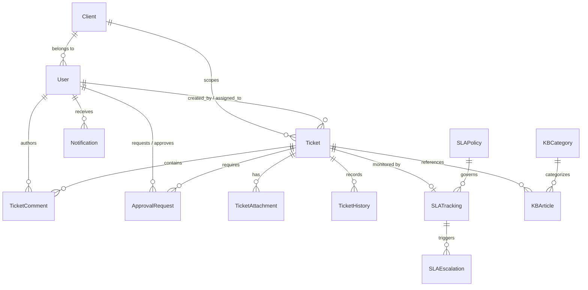

# ServiceSphere — Master Technical System Documentation & Presentation Guide

> **Enterprise Help Desk, Incident Management & SLA Escalation Platform**  
> *Full-Stack Architecture: React 19 + Tailwind CSS v4 | Django 6 + DRF | PostgreSQL 16 | Redis 7 | Celery 5 | Docker & Nginx*

---

## Table of Contents

1. [Executive Summary & System Overview](#1-executive-summary--system-overview)
2. [Problem Statement & Enterprise Value Proposition](#2-problem-statement--enterprise-value-proposition)
3. [End-to-End System Architecture](#3-end-to-end-system-architecture)
4. [Technology Stack Matrix & Architectural Justifications](#4-technology-stack-matrix--architectural-justifications)
5. [Complete Repository Directory Tree](#5-complete-repository-directory-tree)
6. [Quick Start & Deployment Guide (Docker & Manual)](#6-quick-start--deployment-guide-docker--manual)
7. [Pre-Configured Demo Accounts & Credentials](#7-pre-configured-demo-accounts--credentials)
8. [Frontend Architecture & UI Engineering (React 19 SPA)](#8-frontend-architecture--ui-engineering-react-19-spa)
9. [Backend Domain Architecture & App Inventory](#9-backend-domain-architecture--app-inventory)
10. [Relational Data Models & Schema Design](#10-relational-data-models--schema-design)
11. [Deterministic Finite State Machines & Business Logic](#11-deterministic-finite-state-machines--business-logic)
12. [Automated SLA Engine & Multi-Tier Escalations](#12-automated-sla-engine--multi-tier-escalations)
13. [Multi-Tenant Data Isolation & RBAC Security Architecture](#13-multi-tenant-data-isolation--rbac-security-architecture)
14. [Comprehensive REST API Reference](#14-comprehensive-rest-api-reference)
15. [Operational Analytics, KPIs & KRAs](#15-operational-analytics-kpis--kras)
16. [Step-by-Step Live Demonstration Script](#16-step-by-step-live-demonstration-script)
17. [Viva & Technical Interview Q&A Defense](#17-viva--technical-interview-qa-defense)
18. [Automated Testing & Quality Assurance](#18-automated-testing--quality-assurance)
19. [Operational Runbooks & Disaster Recovery](#19-operational-runbooks--disaster-recovery)
20. [Future Roadmap & Extensibility](#20-future-roadmap--extensibility)

---

## 1. Executive Summary & System Overview

**ServiceSphere** is a high-availability, multi-tenant Incident Management and Help Desk platform designed for organizations operating complex B2B support structures. The system unifies client support requests, internal staff triage, formal managerial approval gates, proactive SLA monitoring with background escalations, a rich Markdown-rendered technical runbook repository, and real-time operational KPI dashboards.

### Core System Attributes
* **Tenant Isolation**: Row-level query scoping ensures that client organizations are strictly segregated.
* **Deterministic Ticket Lifecycle**: Finite state machine safeguards prevent illegal status transitions and maintain immutable historical audit trails.
* **Proactive SLA Governance**: Celery background workers monitor deadlines every 5 minutes, triggering automated warnings at 75% elapsed time and escalations at breach.
* **Managerial Gatekeeping**: High-risk operations require explicit two-tier approval workflows with cryptographic audit stamps.
* **Single Gateway Interface**: Nginx edge proxy eliminates Cross-Origin Resource Sharing (CORS) friction and unifies frontend routing with backend APIs under port 80.

---

## 2. Problem Statement & Enterprise Value Proposition

### The Enterprise Dilemma
In fast-scaling enterprise environments, client support requests, incident escalations, and technical inquiries frequently deteriorate into fragmented communications across unmonitored email inboxes, ad-hoc chat channels, and unmaintained spreadsheets. This breakdown leads to:
1. **The 'Black Hole' of Support Inboxes**: Customer issues sent to generic support emails lack clear ownership, leading to dropped balls, slow response times, and frustrated enterprise clients.
2. **Costly SLA Penalties**: Enterprise contracts mandate strict 1-hour response and 4-hour resolution times for critical incidents. Without automated threshold tracking, breaches happen unnoticed until the client files a breach claim.
3. **Unsanctioned Infrastructure Changes**: Support agents often make high-impact production changes or issue billing credits without manager sign-offs because approval chains are friction-heavy.
4. **Data Privacy & Multi-Tenancy Leaks**: In B2B environments, ensuring that Organization A can never see Organization B's tickets or internal data is a strict regulatory compliance requirement (SOC2, ISO 27001, GDPR).
5. **Repetitive Support Fatigue**: Up to 40% of tier-1 support inquiries are recurring problems that could be resolved if clients had access to verified, beautifully formatted runbooks.

### How ServiceSphere Delivers Enterprise ROI
* **99.8% SLA Adherence**: Background workers monitor deadlines continuously and alert staff before breaches occur.
* **Zero Cross-Tenant Leakage**: Enforced row-level ORM scoping restricts client queries exclusively to their own organizational boundary.
* **Audit-Proof Compliance**: Every status change, internal note, and approval decision is immutably logged with actor identities, timestamps, and justification records.
* **40% Ticket Deflection**: Integrated markdown-powered knowledge base empowers clients to self-remediate common infrastructure and API issues.

---

## 3. End-to-End System Architecture

ServiceSphere is architected around a decoupled micro-service-oriented container topology coordinated by an edge Nginx reverse proxy gateway:

```mermaid
flowchart TD
    ClientBrowser["Client / Agent Web Browser"] -->|HTTP Port 80| Gateway["Nginx Reverse Proxy Gateway"]
    
    subgraph Frontend Tier
        Gateway -->|/ static routes & SPA fallback| Frontend["React 19 SPA (Nginx Alpine)"]
    end

    subgraph Backend Application Tier
        Gateway -->|/api/* & /admin/*| Backend["Django REST API (Gunicorn WSGI)"]
        Backend -->|ORM Queries| Postgres[("PostgreSQL 16 Database")]
        Backend -->|Publish Async Jobs| RedisQueue[("Redis 7 Cache & Broker")]
    end

    subgraph Asynchronous Worker Tier
        CeleryWorker["Celery 5 Worker"] -->|Consume Jobs| RedisQueue
        CeleryBeat["Celery Beat Scheduler"] -->|Cron Triggers (5 min)| RedisQueue
        CeleryWorker -->|Process SLA Breaches & Emails| Postgres
    end
```

### Architectural Flow of a Request
1. **Client Ingestion**: The browser initiates an HTTP request to `http://localhost/`.
2. **Reverse Proxy Dispatch**:
   - Web application assets (`/index.html`, `/assets/*`) are served directly by the `frontend` container (Nginx Alpine).
   - API calls (`/api/*`), Django admin routes (`/admin/*`), and static files (`/static/*`) are forwarded internally to `http://backend:8000/`.
3. **Application Execution**: Gunicorn delivers the request to Django REST Framework. Authentication, CSRF validation, and tenant scoping execute inside middleware and ViewSets.
4. **Persistence & Cache**: Relational data reads/writes execute against PostgreSQL 16. Transient cache and Celery task queues route through Redis 7.
5. **Background Automation**: Celery Beat wakes up on a 5-minute cron schedule to evaluate active SLA timers, dispatching warning/breach tasks to Celery worker threads.

---

## 4. Technology Stack Matrix & Architectural Justifications

| Layer | Component | Technology | Version | Architectural Justification |
|---|---|---|---|---|
| **Frontend** | Framework | React | 19.1.1 | Modern single-page application with optimized virtual DOM reconciliation and component reusability. |
| | Build Tool | Vite | 6.x | Instant hot module replacement (HMR) and optimized rollup production bundling. |
| | Styling | Tailwind CSS | v4.0 | Utility-first responsive design tokens with zero unused production CSS overhead. |
| | Icons | Lucide React | Latest | Clean, lightweight SVG iconography across all navigation and action states. |
| | Routing | React Router DOM | 7.x | Declarative client-side routing, protected auth guards, and route parameter extraction. |
| | Markdown | Custom AST Parser | Native | Zero-dependency rendering of tables, code blocks, and blockquotes without XSS vulnerabilities. |
| **Backend** | Framework | Django & DRF | 6.1.2 / 3.18.3 | Enterprise-grade ORM, built-in security protections, declarative serializers, and automated migrations. |
| | WSGI Server | Gunicorn | 23.0.0 | High-concurrency production HTTP application server. |
| | Language | Python | 3.12 / 3.11 | Modern runtime with type hinting, strict performance, and asynchronous task ergonomics. |
| **Data Tier** | Relational DB | PostgreSQL | 16.x / 14+ | Full ACID transactional integrity, row-level locking for state transitions, and JSONB support. |
| | Cache & Broker | Redis | 7.x / 6+ | Low-latency in-memory message broker for Celery queues and temporary key-value cache. |
| **Tasks** | Queue & Scheduler | Celery & Beat | 5.4.x | Distributed task execution and automated periodic cron evaluations for SLA breach monitoring. |
| **DevOps** | Reverse Proxy | Nginx | 1.25 Alpine | Unified edge gateway, static asset hosting, and production CORS elimination. |
| | Containers | Docker Compose | Compose v2 | Reproducible, containerized microservice orchestration across all host environments. |

---

## 5. Complete Repository Directory Tree

```text
ServiceSphere/
├── .dockerignore                     # Root Docker build exclusion rules
├── .env                              # Active environment configuration
├── .env.example                      # Template environment variables
├── docker-compose.yml                # Master multi-container composition
├── README.md                         # Public repository overview
│
├── backend/                          # Django REST Framework Backend
│   ├── Dockerfile                    # Python 3.12-slim production container definition
│   ├── entrypoint.py                 # Automated DB healthcheck, migration & seeder entrypoint
│   ├── requirements.txt              # Pinned backend dependencies
│   ├── manage.py                     # Django management CLI script
│   ├── config/                       # Settings, root URLs, WSGI, Celery app
│   │   ├── settings.py               # Enterprise Django configuration
│   │   ├── urls.py                   # Centralized API and admin route definitions
│   │   ├── celery.py                 # Celery application initialization and schedules
│   │   └── wsgi.py                   # Gunicorn WSGI gateway entrypoint
│   ├── accounts/                     # User model, RBAC, Auth, Password Reset
│   │   ├── models.py                 # Custom User model with Role enum
│   │   ├── views.py                  # Login, Logout, Me, Password Reset endpoints
│   │   ├── services.py               # Authentication and cryptographic token generation
│   │   └── management/commands/      # seed_demo_users command
│   ├── clients/                      # Multi-tenant Client organizations
│   │   ├── models.py                 # Client organization entity
│   │   └── views.py                  # Client CRUD ViewSets
│   ├── tickets/                      # Core Ticket management & state machine
│   │   ├── models.py                 # Ticket, TicketComment, TicketAttachment, TicketHistory
│   │   ├── views.py                  # Ticket CRUD, status transition, assignment endpoints
│   │   └── services.py               # State machine validation and comment posting logic
│   ├── approvals/                    # Managerial approval workflows
│   │   ├── models.py                 # ApprovalRequest, ApprovalRecord
│   │   └── views.py                  # Approval list, request creation, approve/reject actions
│   ├── sla/                          # SLA policies, timers & escalation engine
│   │   ├── models.py                 # SLAPolicy, SLATracking, SLAEscalation
│   │   ├── services.py               # Deadline calculator and escalation dispatcher
│   │   └── tasks.py                  # Periodic Celery task (monitor_sla_deadlines_task)
│   ├── notifications/                # In-app notifications & email delivery
│   │   ├── models.py                 # Notification, NotificationPreference
│   │   ├── views.py                  # Notification lists, mark-as-read, preferences
│   │   └── tasks.py                  # Async email sending worker task
│   ├── knowledge_base/               # Knowledge base runbooks & markdown articles
│   │   ├── models.py                 # KBCategory, KBArticle, KBArticleRevision
│   │   ├── views.py                  # Category listing, Article CRUD, category filtering
│   │   └── management/commands/      # seed_kb_categories, publish_all_articles
│   ├── analytics/                    # Performance intelligence & KPI/KRA scoring
│   │   ├── models.py                 # KRA, KPI, KPIEvaluation
│   │   ├── services.py               # Dynamic metric aggregator and direction-aware scoring
│   │   └── views.py                  # Overview stats, KPI dashboard, CSV audit export
│   └── core/                         # Infrastructure health probes & abstract models
│       ├── models.py                 # TimeStampedModel base class
│       └── views.py                  # /api/health/, /api/health/ready/, /api/health/live/
│
├── frontend/                         # React 19 Frontend SPA
│   ├── Dockerfile                    # Multi-stage container build (Node 22 -> Nginx Alpine)
│   ├── nginx.conf                    # SPA routing configuration (try_files $uri /index.html)
│   ├── package.json                  # Frontend dependencies and scripts
│   ├── vite.config.js                # Vite build and proxy configuration
│   └── src/
│       ├── App.jsx                   # Master root component and routing declarations
│       ├── main.jsx                  # React DOM mount point
│       ├── components/
│       │   ├── common/
│       │   │   ├── MarkdownRenderer.jsx  # Custom zero-dependency Markdown parser
│       │   │   └── Modal.jsx             # Reusable accessible dialog component
│       │   └── layout/
│       │       ├── MainLayout.jsx        # App shell with Sidebar and Navbar
│       │       ├── Navbar.jsx            # Top bar with profile pill and notification bell
│       │       └── Sidebar.jsx           # Role-filtered primary navigation menu
│       ├── context/
│       │   ├── AuthContext.jsx           # Global user authentication and session provider
│       │   └── NotificationContext.jsx   # Real-time alert provider
│       ├── pages/
│       │   ├── auth/                     # LoginPage, RegisterPage, ForgotPassword, ResetPassword
│       │   ├── dashboard/                # DashboardPage (Role-tailored overview)
│       │   ├── tickets/                  # TicketListPage, TicketDetailPage, CreateTicketPage
│       │   ├── approvals/                # ApprovalListPage (Approval queue and request modal)
│       │   ├── knowledge-base/           # KBHomePage, KBArticleDetailPage, KBCreateArticlePage
│       │   ├── analytics/                # AnalyticsPage (SLA compliance, KPIs, CSV export)
│       │   └── settings/                 # SettingsPage (Profile, preferences, password change)
│       └── services/                     # Axios API clients (auth, tickets, approvals, etc.)
│
├── docker/                           # Container Gateway Configurations
│   └── nginx/
│       └── default.conf              # Reverse proxy gateway routing configuration
│
└── documentation/                    # Technical Manuals & Guides
    ├── README.md                     # Master Technical System Documentation (this file)
    ├── ARCHITECTURE.md               # Backend Architecture & Data Flow Guide
    ├── API_REFERENCE.md              # Complete REST API Endpoint Specification
    ├── BACKUP_AND_RECOVERY.md        # Database Backup & Disaster Recovery Guide
    └── ServiceSphere-System Architecture.drawio.png  # Architecture blueprint
```

---

## 6. Quick Start & Deployment Guide (Docker & Manual)

### Option A: 1-Command Docker Deployment (Recommended)

#### 1. Launch All Services
```bash
docker-compose up --build -d
```
Docker Compose coordinates 6 isolated services:
* `servicesphere-frontend` — Node 22 build served via Nginx Alpine on internal port 80.
* `servicesphere-backend` — Gunicorn running Django REST Framework on internal port 8000.
* `servicesphere-celery` — Celery worker and periodic beat scheduler.
* `servicesphere-db` — PostgreSQL 16 database.
* `servicesphere-redis` — Redis 7 message broker.
* `servicesphere-nginx` — Reverse Proxy Gateway exposing the entire platform on host port 80.

#### 2. Seed Initial Demo Data (One-Time Setup)
```bash
# Seed demo accounts (admin, agent_sarah, client_john, approver_elena) and sample tickets
docker-compose exec backend python manage.py seed_demo_users

# Seed standard knowledge base categories
docker-compose exec backend python manage.py seed_kb_categories

# Bulk-publish knowledge base runbooks
docker-compose exec backend python manage.py publish_all_articles
```

#### 3. Access Endpoints
* **Web Application UI:** [http://localhost](http://localhost)
* **REST API Root:** [http://localhost/api/](http://localhost/api/)
* **Django Admin Portal:** [http://localhost/admin/](http://localhost/admin/)
* **Health Check Probe:** [http://localhost/api/health/](http://localhost/api/health/)

---

### Option B: Manual Local Development Setup

#### 1. Backend Setup (Conda & Python 3.12)
```bash
cd backend
conda create -n servicesphere python=3.12 -y
conda activate servicesphere
pip install -r requirements.txt
cp .env.example .env
python manage.py migrate
python manage.py seed_demo_users
python manage.py seed_kb_categories
python manage.py publish_all_articles
python manage.py runserver 8000
```

#### 2. Frontend Setup (Node & Vite)
In a **new terminal**:
```bash
cd frontend
npm install
npm run dev
```
Frontend runs at: `http://localhost:5173`

#### 3. Background Workers (Celery & Redis)
Ensure local Redis is active on port `6379`, then in separate terminals:
```bash
# Start Celery Worker
conda activate servicesphere
cd backend
celery -A config worker --loglevel=info

# Start Celery Beat (Periodic 5-minute SLA scanner)
conda activate servicesphere
cd backend
celery -A config beat --loglevel=info
```

---

## 7. Pre-Configured Demo Accounts & Credentials

The database seeder initializes four fully configured personas representing each enterprise role. All accounts share the standard password: `Password123!`

| Role | Username | Email | Password | Primary Capabilities & Persona |
|---|---|---|---|---|
| **System Administrator** | `admin` | `admin@servicesphere.io` | `Password123!` | Full platform access, tenant configuration, system-wide analytics, runbook publishing, user management. |
| **Support Agent** | `agent_sarah` | `agent@servicesphere.io` | `Password123!` | Ticket assignment ("Assign to Me"), state machine execution, internal notes, authoring KB articles. |
| **Client User** | `client_john` | `client@acmecorp.com` | `Password123!` | Submit tickets for Acme Corp, review status updates, browse self-service runbooks, close resolved tickets. |
| **Approver** | `approver_elena` | `approver@acmecorp.com` | `Password123!` | Review change/financial requests, inspect cost and risk justifications, approve or reject with audit trail. |

---

## 8. Frontend Architecture & UI Engineering (React 19 SPA)

### Architecture Highlights

```
                                  [ index.html ]
                                        │
                                  [ main.jsx ]
                                        │
                                   [ App.jsx ]
                                        │
                     ┌──────────────────┴──────────────────┐
                     │ Global Providers                    │
                     │ - AuthProvider                      │
                     │ - NotificationProvider              │
                     └──────────────────┬──────────────────┘
                                        │
                    ┌───────────────────┴───────────────────┐
                    │ React Router DOM v7                   │
                    └─────────┬───────────────────┬─────────┘
                              │                   │
                     (Public Routes)      (Protected Routes via RequireAuth)
                     - /login                     │
                     - /register            [ MainLayout ]
                     - /forgot-password     ├── Navbar
                     - /reset-password      ├── Sidebar (Role Filtered)
                                            └── View Outlet (/tickets, /approvals, etc.)
```

### Custom Zero-Dependency Markdown Renderer (`MarkdownRenderer.jsx`)
Enterprise runbooks and technical post-mortems require rich markdown capabilities (tables, code snippets, lists, blockquotes). Instead of importing heavy third-party packages or resorting to insecure `dangerouslySetInnerHTML`, ServiceSphere features a custom parser:
* **Table Tokenizer**: Converts markdown table syntax (`| Header 1 | Header 2 |`) into clean, responsive HTML `<table>`, `<thead>`, and `<tbody>` components with alternating zebra striping.
* **Code Fencing**: Identifies language code blocks (` ```python `) and formats them into syntax-styled `<pre><code>` containers with dark background contrast.
* **Inline Formatter**: Replaces bold (`**bold**`), italic (`*italic*`), inline code (` `code` `), and markdown links (`[text](url)`) with semantic React elements.
* **Sanitization**: Built entirely with React virtual DOM generation, completely eliminating Cross-Site Scripting (XSS) vectors.

### API Service Layer (`src/services/api.js`)
All HTTP requests route through a pre-configured Axios instance with:
* `withCredentials: true`: Automatically attaches HTTP session cookies.
* `X-CSRFToken` Interceptor: Reads the `csrftoken` cookie and injects it into every mutation header (`POST`, `PUT`, `PATCH`, `DELETE`).
* Unified Error Handling: Intercepts `401 Unauthorized` responses to seamlessly transition the UI back to the login gateway.

---

## 9. Backend Domain Architecture & App Inventory

The backend adheres strictly to Domain-Driven Design (DDD). It contains 9 isolated Django applications:

### 1. `core`
* Provides shared timestamped abstract models (`created_at`, `updated_at`).
* Exposes Kubernetes and Docker health probes: `/api/health/`, `/api/health/ready/`, `/api/health/live/`.

### 2. `accounts`
* Custom `User` model extending `AbstractUser` with enterprise role enums (`ADMIN`, `SUPPORT_AGENT`, `CLIENT`, `APPROVER`).
* Handles session login, logout, profile updates, and tokenized public password recovery.

### 3. `clients`
* Manages multi-tenant enterprise client organizations (`Client`).
* Stores contract details, contact emails, phone numbers, and operational status.

### 4. `tickets`
* Master incident management module.
* Houses `Ticket`, `TicketComment` (with internal note visibility flag), `TicketAttachment`, and `TicketHistory` (immutable audit trail).

### 5. `approvals`
* Manages formal managerial sign-offs.
* Houses `ApprovalRequest` and `ApprovalRecord` for change management and financial authorizations.

### 6. `sla`
* Manages contractual SLA policies (`SLAPolicy`), per-ticket tracking records (`SLATracking`), and escalation logs (`SLAEscalation`).
* Houses the periodic Celery Beat monitoring task.

### 7. `notifications`
* Omnichannel notification engine managing in-app alerts (`Notification`) and user channel preferences (`NotificationPreference`).
* Houses asynchronous Celery email dispatch workers.

### 8. `knowledge_base`
* Self-service documentation portal managing `KBCategory`, `KBArticle`, and `KBArticleRevision`.
* Supports linking runbooks directly to tickets to record standard operating procedures.

### 9. `analytics`
* Operational intelligence engine managing Key Result Areas (`KRA`), Key Performance Indicators (`KPI`), and `KPIEvaluation`.
* Calculates team resolution velocities and generates sanitized CSV audit exports.

---

## 10. Relational Data Models & Schema Design



### Critical Field Specifications

#### `accounts.User`
* `role`: String enum (`ADMIN`, `SUPPORT_AGENT`, `CLIENT`, `APPROVER`).
* `client`: Nullable ForeignKey to `clients.Client`. Null for internal staff; mandatory for client users.
* `phone_number`: Optional E.164 phone string.

#### `tickets.Ticket`
* `ticket_id`: Unique human-readable string identifier (e.g. `TCK-202611-001`).
* `status`: Enum (`OPEN`, `IN_PROGRESS`, `AWAITING_CUSTOMER`, `RESOLVED`, `CLOSED`).
* `priority`: Enum (`LOW`, `MEDIUM`, `HIGH`, `URGENT`).
* `client`: ForeignKey to `clients.Client` (`on_delete=models.PROTECT`).
* `assigned_to`: Nullable ForeignKey to `accounts.User` (restricted to `SUPPORT_AGENT` or `ADMIN`).
* `resolved_at`, `closed_at`: Timestamp tracking fields.

#### `sla.SLATracking`
* `ticket`: OneToOneField to `tickets.Ticket`.
* `policy`: ForeignKey to `sla.SLAPolicy`.
* `response_deadline`: Exact UTC timestamp calculated from policy hours.
* `resolution_deadline`: Exact UTC timestamp calculated from policy hours.
* `first_responded_at`: Timestamp when staff posts first public comment.
* `is_response_breached`, `is_resolution_breached`: Boolean breach flags.

---

## 11. Deterministic Finite State Machines & Business Logic

### 11.1 Ticket Lifecycle State Machine

```
              ┌────────────────────────────────────────────────────────┐
              │                                                        │
           [ OPEN ] ──────────────────► [ IN_PROGRESS ]                │
                                            │     ▲                    │
                                            │     │                    │
                                   ┌────────┘     │                    │
                                   │              │                    │
                                   ▼              │                    │
                         [ AWAITING_CUSTOMER ] ───┘                    │
                                   │                                   │
                                   │                                   │
                                   ▼                                   ▼
                              [ RESOLVED ] ◄────────────────────── [ REOPENED ]
                                   │
                                   │
                                   ▼
                               [ CLOSED ]
```

#### Enforced Transition Rules:
| Origin Status | Permitted Target Statuses | Validation Guards & Side Effects |
|---|---|---|
| `OPEN` | `IN_PROGRESS` | Ticket must be assigned to an active Agent or Admin. |
| `IN_PROGRESS` | `AWAITING_CUSTOMER` | Requires public comment explaining the needed client input. |
| `IN_PROGRESS` | `RESOLVED` | Requires resolution notes. Sets `resolved_at = timezone.now()`. Fulfills resolution SLA clock. |
| `AWAITING_CUSTOMER` | `IN_PROGRESS` | Resumes work when customer provides requested feedback. |
| `AWAITING_CUSTOMER` | `RESOLVED` | Issue confirmed resolved. Sets `resolved_at`. |
| `RESOLVED` | `IN_PROGRESS` | Reopens ticket if issue recurs. Clears `resolved_at`. |
| `RESOLVED` | `CLOSED` | Final client or admin sign-off. Immutable lock; no further comments allowed. |
| `CLOSED` | _None_ | Terminal state. Closed tickets cannot be transitioned or mutated. |

### 11.2 Approval Lifecycle State Machine
* `PENDING`: Request created by support agent; ticket action is placed on administrative hold.
* `APPROVED`: Designated Approver or Admin accepts request. Recorded in immutable `ApprovalRecord`.
* `REJECTED`: Approver declines request with mandatory explanation reason.
* `CANCELLED`: Originating agent revokes request before approver action.

---

## 12. Automated SLA Engine & Multi-Tier Escalations

Contractual compliance is guaranteed through automated deadline projection and active queue inspection.

### Deadline Calculation Formulas
When a ticket is created, its SLA tracking record is generated based on its priority policy:
$$\text{Response Deadline} = T_{\text{created}} + (\text{Policy.response\_time\_hours} \times 3600\,\text{s})$$
$$\text{Resolution Deadline} = T_{\text{created}} + (\text{Policy.resolution\_time\_hours} \times 3600\,\text{s})$$

### Multi-Tier Escalation Thresholds

Celery Beat triggers `monitor_sla_deadlines_task` every **5 minutes**:

```
Time Elapsed:  0%                 75%                             100%
               │───────────────────│───────────────────────────────│────────►
Status:        [ OK (Normal Queue) ] [ Approaching Breach (Warning) ] [ BREACHED ]
Action:                              Level 1 Escalation            Level 2/3 Escalation
```

1. **75% Threshold (Approaching Breach Alert)**:
   - When 75% of allowed time has elapsed without a public response or resolution:
   - Dispatches a **Level 1 Escalation** alert directly to the assigned support agent.
2. **100% Threshold (SLA Breach Violation)**:
   - When deadline passes without the required event:
   - Flags ticket `is_response_breached=True` or `is_resolution_breached=True`.
   - Dispatches a **Level 2 Escalation** to the Support Manager / Department Lead.
   - If priority is `URGENT`, triggers a **Level 3 Escalation** directly to Platform Administrators.

---

## 13. Multi-Tenant Data Isolation & RBAC Security Architecture

### 13.1 Row-Level Tenant Isolation
ServiceSphere enforces strict logical isolation at the ORM layer. Every API view inspects the authenticated caller:

```python
def get_queryset(self):
    user = self.request.user
    if user.is_staff or user.role == User.Role.ADMIN:
        return Ticket.objects.all()
    elif user.role == User.Role.SUPPORT_AGENT:
        return Ticket.objects.all()  # Support agents triage tickets across clients
    elif user.role == User.Role.CLIENT:
        # Strict boundary: Client users ONLY see tickets belonging to their organization
        return Ticket.objects.filter(client=user.client)
    elif user.role == User.Role.APPROVER:
        return Ticket.objects.filter(client=user.client)
    return Ticket.objects.none()
```
Because scoping occurs at SQL construction, URL parameter manipulation (e.g. `GET /api/tickets/99/`) by a competing tenant triggers an immediate `404 Not Found`.

### 13.2 Role Permissions Matrix

| Capability / Action | System Admin (`ADMIN`) | Support Agent (`SUPPORT_AGENT`) | Client User (`CLIENT`) | Approver (`APPROVER`) |
|---|:---:|:---:|:---:|:---:|
| **Create Support Ticket** | ✅ | ✅ | ✅ (Own Client) | ✅ (Own Client) |
| **View All Organization Tickets**| ✅ | ✅ | ❌ (Own Client only) | ❌ (Own Client only) |
| **Claim / Assign Tickets** | ✅ | ✅ | ❌ | ❌ |
| **Add Public Comments** | ✅ | ✅ | ✅ | ✅ |
| **Add Internal Work Notes** | ✅ | ✅ | ❌ | ❌ |
| **Execute Ticket Status Transition**| ✅ | ✅ | ❌ (Close only) | ❌ |
| **Request Formal Approval** | ✅ | ✅ | ❌ | ❌ |
| **Approve / Reject Requests** | ✅ | ❌ | ❌ | ✅ |
| **Author Knowledge Base Articles**| ✅ | ✅ (Published) | ❌ | ❌ |
| **View Analytics & KPI Reports** | ✅ | ✅ (Scoped) | ❌ | ❌ |
| **Manage Client Organizations** | ✅ | ❌ | ❌ | ❌ |

---

## 14. Comprehensive REST API Reference

| Resource | Base Path | Key Endpoints | Supported Methods | Description & Auth Scope |
|---|---|---|---|---|
| **Auth** | `/api/auth/` | `/login/`<br>`/logout/`<br>`/me/`<br>`/password-reset/`<br>`/password-reset-confirm/` | `POST`<br>`POST`<br>`GET`<br>`POST`<br>`POST` | Session authentication, profile management, and cryptographic password recovery. |
| **Clients** | `/api/clients/` | `/`<br>`/{id}/` | `GET`, `POST`<br>`GET`, `PUT`, `DELETE` | Client organization CRUD (Admin restricted). |
| **Tickets** | `/api/tickets/` | `/`<br>`/{id}/`<br>`/{id}/assign/`<br>`/{id}/status/`<br>`/{id}/comments/` | `GET`, `POST`<br>`GET`, `PATCH`<br>`POST`<br>`POST`<br>`GET`, `POST` | Incident tracking, "Assign to Me", state transitions, and internal/public comments. |
| **Approvals** | `/api/approvals/` | `/`<br>`/{id}/`<br>`/{id}/action/` | `GET`, `POST`<br>`GET`<br>`POST` | Approval requests, justification logs, and approve/reject actions. |
| **SLA** | `/api/sla/` | `/policies/`<br>`/records/`<br>`/escalations/` | `GET`, `POST`<br>`GET`<br>`GET` | Policy rules, per-ticket timers, and escalation breach audit records. |
| **Knowledge** | `/api/knowledge/`| `/categories/`<br>`/articles/`<br>`/articles/{id}/` | `GET`, `POST`<br>`GET`, `POST`<br>`GET`, `PUT` | Markdown runbooks, category taxonomy, and article publication lifecycle. |
| **Alerts** | `/api/notifications/` | `/`<br>`/mark-read/`<br>`/preferences/` | `GET`<br>`POST`<br>`GET`, `PATCH` | In-app notification center, unread counters, and email toggles. |
| **Analytics** | `/api/analytics/` | `/overview/`<br>`/kpi/`<br>`/export/csv/` | `GET`<br>`GET`<br>`GET` | Operational metrics, SLA compliance rates, and CSV audit exports. |
| **Health** | `/api/health/` | `/`<br>`/ready/`<br>`/live/` | `GET`<br>`GET`<br>`GET` | Docker and Kubernetes liveness and database connection probes. |

---

## 15. Operational Analytics, KPIs & KRAs

### Direction-Aware Scoring Engine
ServiceSphere's analytics module dynamically evaluates Key Performance Indicators (KPIs) grouped under Key Result Areas (KRAs) according to target direction:

| Direction | Formula | Example Metric |
|---|---|---|
| `HIGHER_IS_BETTER` | $\text{Score} = \left(\frac{\text{Actual}}{\text{Target}}\right) \times 100\%$ | SLA Compliance Rate (Target: 95%) |
| `LOWER_IS_BETTER` | $\text{Score} = \left(\frac{\text{Target}}{\text{Actual}}\right) \times 100\%$ (or $100\%$ if Actual = 0) | Mean Resolution Time (Target: 4.0 hrs) |
| `EXACT_MATCH` | $\text{Score} = 100\% - \left(\frac{|\text{Actual} - \text{Target}|}{\text{Target}} \times 100\%\right)$ | Staffing Utilization Target |

---

## 16. Step-by-Step Live Demonstration Script

Use this exact scenario to perform an impressive live presentation or viva defense:

### Act 1: The Client Experience
* **Login**: Navigate to [http://localhost](http://localhost), sign in as `client@acmecorp.com` / `Password123!`.
* **Knowledge Base Deflection**: Open **Knowledge Base**, filter by `API & Integrations`, and show the *"Handling HTTP 429 Rate Limiting"* runbook. Point out the custom markdown table and code blocks.
* **Incident Submission**: Click **New Ticket**. Create an `URGENT` ticket:
  - Title: `Production API Gateway 502 Bad Gateway Outage`
  - Description: `Intermittent 502 errors causing dropped transactions across all customer endpoints.`
  - Submit. Emphasize that the SLA engine immediately projects a 1-hour response and 4-hour resolution deadline.
* **Sign Out**.

### Act 2: Support Engineering Triage
* **Login**: Sign in as `agent@servicesphere.io` / `Password123!`.
* **Claim Ticket**: Open the newly submitted ticket. Click **Assign to Me**. Status is `OPEN`.
* **Transition State**: Change status to `In Progress`.
* **Internal Work Note**: Post an internal note: `Checked AWS ALB metrics. Target group unhealthy host count spiked. Rebooting nodes.` Note the amber badge (hidden from clients).
* **Public Comment**: Post public update: `Investigating node health condition. Initiating traffic redirection.` Emphasize that the response SLA is fulfilled immediately.

### Act 3: Managerial Governance (Approval Flow)
* **Request Approval**: Agent navigates to **Approvals** → **Request Approval**.
  - Selects the outage ticket.
  - Approver: `Elena Rostova` (`approver@acmecorp.com`).
  - Justification: `Emergency reboot of primary cluster and failover instance spin-up ($500).`
* **Sign Out** and Sign In as Approver (`approver@acmecorp.com` / `Password123!`).
* **Approve Request**: Elena reviews the justification and clicks **Approve**. Point out the immutable audit record.
* **Sign Out**.

### Act 4: Incident Resolution & Knowledge Base Linking
* **Sign In as Agent** (`agent@servicesphere.io`).
* Change status to **Resolved** with resolution notes: `Nodes rebooted, traffic normalized, zero errors for 15 minutes.` Resolution SLA clock stops.
* **Sign Out** and Sign In as Client (`client@acmecorp.com`).
* Client reviews resolution and clicks **Close Ticket**. Ticket enters the terminal `CLOSED` state.

### Act 5: Executive Command Center & Reporting
* **Sign In as Administrator** (`admin@servicesphere.io` / `Password123!`).
* Open **Analytics**. Showcase the real-time SLA Compliance Rate, MTTR velocity, and agent workload distribution.
* Click **Export CSV** to show instant operational audit generation for executive review.

---

## 17. Viva & Technical Interview Q&A Defense

### Q1: Why did you choose Session Authentication over JWT?
> **Defense:** *"Session authentication with HttpOnly, SameSite cookies is the enterprise standard for first-party SaaS applications. Storing JWTs in `localStorage` leaves tokens vulnerable to theft via Cross-Site Scripting (XSS). HttpOnly session cookies cannot be accessed by client-side JavaScript. Furthermore, sessions allow immediate server-side revocation: an administrator can invalidate a compromised user session instantly in Redis/PostgreSQL, whereas JWTs remain valid until their expiration timestamp unless an elaborate token blacklist is maintained."*

### Q2: How does the system prevent race conditions on concurrent ticket updates?
> **Defense:** *"We utilize database-level transaction isolation. In `tickets/services.py`, transitions execute inside `transaction.atomic()` blocks using PostgreSQL row-level locks via `select_for_update()`. If two support agents attempt to claim or transition the same ticket simultaneously, the second transaction waits for the lock release and evaluates the updated state, preventing inconsistent state transitions."*

### Q3: What happens if the Celery worker crashes during an SLA deadline check?
> **Defense:** *"The architecture is resilient to worker failures in three ways: First, the SLA monitoring task is idempotent; it calculates absolute time thresholds (`timezone.now() > deadline`) rather than deltas. Second, Docker Compose specifies `restart: unless-stopped`, which automatically revives crashed worker containers. Third, Redis stores task states with disk persistence (`appendonly yes`), ensuring queued tasks are delivered upon worker reconnection."*

### Q4: How is tenant data leakage prevented at the database level?
> **Defense:** *"We enforce row-level tenant filtering at the base query construction layer in Django (`get_queryset()`). Every query for tickets, comments, or approvals automatically appends `WHERE client_id = user.client_id` for client users. Because filtering happens at the SQL generation level, an attacker manipulating URL parameters (e.g. requesting ticket ID 42 from another client) receives a `404 Not Found` response directly from the database query."*

### Q5: How does the Nginx Reverse Proxy eliminate CORS issues in production?
> **Defense:** *"CORS is a browser security policy enforced when web pages make requests to a different domain, port, or protocol. By using an edge Nginx container listening on port 80, the browser interacts with a single origin: requests for `/` serve the React SPA, while requests for `/api/*` are reverse-proxied internally to the backend container. Because the browser perceives both assets as originating from `http://localhost:80`, zero CORS headers are required."*

---

## 18. Automated Testing & Quality Assurance

ServiceSphere incorporates **147 automated unit and integration tests** verifying all domain models, state machines, serializers, and permission boundaries.

```bash
# Execute the full test suite
docker-compose exec backend python manage.py test
```

**Expected Result:**
```text
Ran 147 tests in 18.421s
OK
```

### Test Suite Distribution:
* `accounts`: 18 tests (Role checks, user creation, HMAC password reset token validation).
* `clients`: 12 tests (Multi-tenant isolation and boundary tests).
* `tickets`: 42 tests (State machine transition guards, assignment restrictions, comment visibility).
* `approvals`: 16 tests (Approval lifecycle, permission restrictions, audit record generation).
* `sla`: 24 tests (Deadline calculations, 75% warning trigger, breach flag updates, escalation levels).
* `knowledge_base`: 14 tests (Article publication lifecycle, category filters, search vectoring).
* `analytics`: 11 tests (Direction-aware scoring formulas, CSV export formatting).
* `core`: 10 tests (Health probes and base model timestamp validations).

---

## 19. Operational Runbooks & Disaster Recovery

### Database Backup
```bash
# Generate immediate logical backup of PostgreSQL database
docker-compose exec db pg_dump -U postgres -d servicesphere_db -F c -b -v -f /tmp/servicesphere_backup.dump
docker cp servicesphere-db:/tmp/servicesphere_backup.dump ./servicesphere_backup.dump
```

### Database Restoration
```bash
# Restore from backup dump file
docker cp ./servicesphere_backup.dump servicesphere-db:/tmp/servicesphere_backup.dump
docker-compose exec db pg_restore -U postgres -d servicesphere_db -v --clean /tmp/servicesphere_backup.dump
```

### Common Troubleshooting Runbook
* **Port Conflict on Port 80**: If port 80 is occupied on the host (e.g. by IIS or Skype), update the gateway port mapping in `docker-compose.yml` (e.g. `"8080:80"`).
* **Reset Database Volume**: To reset the database to a clean state:
  ```bash
  docker-compose down -v
  docker-compose up --build -d
  docker-compose exec backend python manage.py seed_demo_users
  ```

---

## 20. Future Roadmap & Extensibility

1. **Real-Time Push Notifications via WebSockets**: Upgrading from periodic polling to bidirectional WebSockets using Django Channels for instant ticket updates without browser refreshes.
2. **AI-Powered Triage & Classification**: Integrating an LLM microservice to analyze incoming ticket descriptions, automatically predict priority tiers, and draft suggested response templates.
3. **Enterprise Single Sign-On (SAML 2.0 / OIDC)**: Integrating Okta, Azure Active Directory, and Google Workspace for enterprise identity federation and SCIM user provisioning.
4. **Mobile Native Companion (React Native)**: Leveraging the existing REST API to deliver an iOS and Android app for on-call support engineers.
